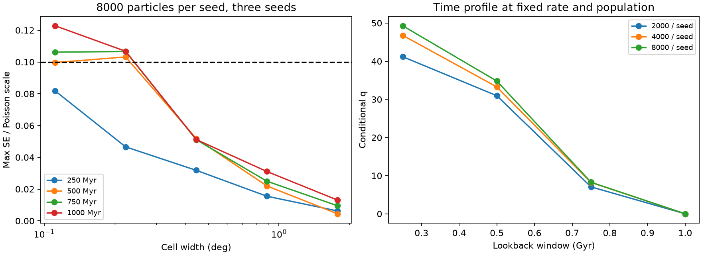
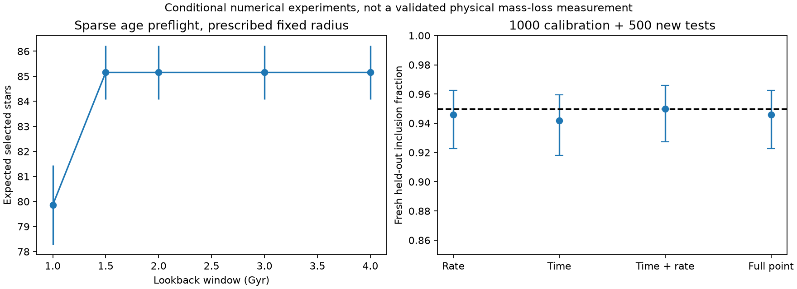

# 增加粒子與修正校準的測試結果

日期：2026 年 10 月 29 日。此次為改善方法的實測，並非已驗證的絕對 MLR 測量。

## 1 粒子與空間尺度

對 MLR = 9 M☉/Myr、人口 tilt = 0，三個獨立種子各積分 8000 粒子，T_max = 1 Gyr，相當於前尾與後尾每 Myr 各四個分層時間取樣。總計 24000 條軌跡。以原視野、遮罩、背景與觀測條件比較四個 T。

| 名義像素寬度 | T Myr | 主要像素最差模板 SE 除以 Poisson 尺度 | 低於 0.1 |
|---|---:|---:|---|
| 0.111° | 250 | 0.082 | 是 |
| 0.111° | 500 | 約 0.100，未四捨五入值小於 0.1 | 是 |
| 0.111° | 750 | 0.106 | 否 |
| 0.111° | 1000 | 0.123 | 否 |
| 0.444° | 250 | 0.032 | 是 |
| 0.444° | 500 | 0.052 | 是 |
| 0.444° | 750 | 0.051 | 是 |
| 0.444° | 1000 | 0.051 | 是 |

增加粒子明顯降低噪聲，但細像素並未全面通過。三個種子的變異估計也仍不精確；這個測試只涵蓋一個流失率及人口假設。

從同一批軌跡作保持各時間區間質量的巢狀取樣，4000→8000 的 TV 約 0.044–0.057；這些層級相關，不能冒充獨立證明。真正不同種子的 8000 粒子圖，配對 TV 約 0.110–0.148。

固定 MLR 與人口的時間 profile 中，巢狀 4k→8k 的最大 q 差異，細網格約 2.50，0.444° 網格約 0.13。這不是完整 MLR profile；不能直接據此宣稱 MLR 已收斂。粗分箱會減少資訊，需在所有候選模型採一致設定並重新校準。

完整 1 Gyr 模型另檢查觀測抽樣誤差：其主要像素最大 SE/Poisson 比約 0.0021，明顯小於動力學種子差異約 0.123。此數字是條件式診斷，不包含全部校正系統誤差；短 T 尚未儲存完整逐次觀測抽樣，因此沒有相同精度的誤差拆分。

## 2 逃逸年代預演

另跑三個種子、各 400 粒子，延伸至 4 Gyr。此稀疏模型只作年代貢獻預演，不能作精密空間推論。

| T Gyr | 平均預期選中訊號星數 | 三種子平均的標準誤 |
|---|---:|---:|
| 1 | 79.86 | 1.59 |
| 1.5 | 85.15 | 1.07 |
| 2 | 85.15 | 1.07 |
| 3 | 85.15 | 1.07 |
| 4 | 85.15 | 1.07 |

在此指定模型中，1–1.5 Gyr 人口約增加 6.2% 的最終預期訊號；更早的抽樣人口沒有再增加。零取樣結果不等於物理貢獻精確為零。模型固定尺度，4 Gyr 前質量約為現在 3.69 倍，結構演化近似仍需驗證。

下一個合理確認範圍是高取樣的 1.5–2 Gyr，而非直接假設 1 Gyr 足夠，或把整段 4 Gyr 全部密集積分。

## 3 Profile 統計與有限排序門檻

新增 `profile_recovery.py`，分開計算 MLR profile、T profile、T–MLR 聯合區域及固定完整候選點。門檻使用 k = ceil((m+1) × 0.95) 的排序；樣本不足時採保守處理，不使用未修正的百分位近似。

先跑三個固定模板情境，各 200 次校準及 300 次留出測試。T = 0.5 Gyr 的 MLR 涵蓋率約 90.7%，T = 1 Gyr 約 95%，顯示單一校準批次的變動仍重要。

後續預先固定更大實驗：將舊 T500 的 500 個分數轉作校準／開發資料，另以獨立 seed = 271828 產生 500 個校準與 500 個全新留出樣本。以 1000 個校準分數的第 951 小值決定門檻，不依全新留出結果調整。

| 目標 | 全新 500 次測試涵蓋率 | Wilson 95% 區間 |
|---|---:|---|
| MLR profile | 94.6% | 92.3–96.3% |
| T profile | 94.2% | 91.8–95.9% |
| T–MLR 聯合區域 | 95.0% | 92.7–96.6% |
| 完整候選點 | 94.6% | 92.3–96.3% |

這些比例與名義 95% 相容，但只驗證特定真值、固定模板與背景下的統計流程；不代表所有干擾參數的涵蓋率均受保證。Wilson 區間描述固定校準門檻下的測試比例，不包含校準批次的全部不確定性。

初始追蹤測試曾在啟動審查中發現 CLI 預設 seed 會重複舊樣本，該啟動已中止並排除；實際後續實驗明確使用 seed 271828。程式現提供 `--seed`，獨立實驗必須指定不同種子。

總計使用 2500 個不同的模擬資料集；轉作校準的舊樣本不再宣稱為最終獨立留出測試。

## 4 軟體檢查與操作

60 項測試通過，包括分層權重、巢狀取樣、完整分析串接、profile 目標與排序門檻。分析腳本曾發生密度比較的順序錯誤，已修正並加入完整串接回歸測試；沒有改動已生成的軌道或觀測模板。原分析計畫與修正紀錄均保留。

```powershell
.\.venv\Scripts\python.exe dense_convergence.py --study outputs/Pal5_dense_8000_v1 --selection outputs/Pal5_real_inputs_baseline/selection --out outputs/new_dense_analysis

.\.venv\Scripts\python.exe profile_recovery.py --templates-manifest outputs/Pal5_joint_validation_v1/baseline/templates.json --manifest outputs/profile_recovery_v2_inputs/enlarged_independent_injections.json --out outputs/new_profile_test --calibration 500 --validation 500 --seed 271828

.\.venv\Scripts\python.exe summarize_improvement_tests.py
```

重跑應保留舊輸出並選新目錄。`summarize_improvement_tests.py` 使用已保存的固定實驗資料，會產生總結圖與來源雜湊。

## 5 使用結論

8000 粒子／種子、三種子與約 0.444° 分箱，是下一輪總量分析的合理候選設定；仍需對所有 MLR 一致測試，再高取樣確認 1.5–2 Gyr。不能只提高最佳 MLR 的模板精度，讓其他候選留在低精度。

細尾巴形態、逃逸人口、背景與半徑演化尚未全部驗證，不能宣稱取得精確物理 MLR。

原始圖表與完整資料：`outputs/Pal5_improvement_tests_v1/REPORT_ZH.md`、`summary.json`、`unittest.log`。研究產物在被 Git 忽略的 outputs 中；本文件保留可納入版本控制的結果摘要。

公開的小型彙總表見 [results](results/README.md)。以下圖保留了條件與限制，不是正式物理 MLR 的最終測量。




