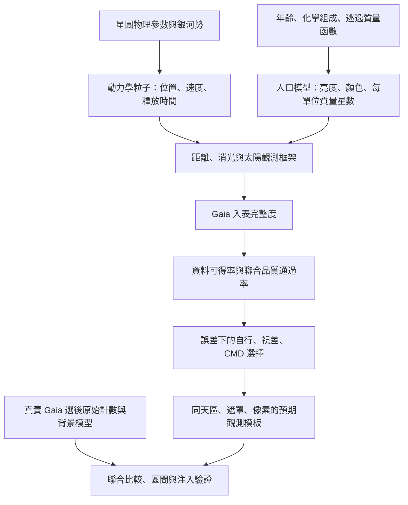

# 後續製作規劃：從動力學星流到可比較的 Gaia 觀測

更新：2026-10-27。

實作更新：人口、完整度、品質與誤差響應、時間歷史再加權、多模板比較及快取的程式接口已加入 v2。
本文件保留設計規格；目前可執行方式與仍有的近似見 [Observation v2](OBSERVATION_V2.md)。
真實校正、完整原始星表注入、背景／物理系統誤差與自洽質量演化仍需要後續研究。

本文件是下一階段的實作規格。標記為「預計」的內容尚未完成；撰寫本文件不代表已安裝 GaiaUnlimited、取得真實人口校正或升級觀測模型。

## 1. 研究目標與交付層級

先完成一顆星團可重現的觀測比較，再擴展多星團。

| 層級 | 要回答的問題 | 可以交付的結果 | 先決條件 |
|---|---|---|---|
| A：觀測結構 | 選後資料有哪些尾巴候選結構？ | 計數圖、候選段、條件式可追蹤尺度 | 選星、背景、遮罩及偵測設定已記錄 |
| B：形狀與運動比較 | 哪個動力學模型較符合觀測？ | 二維殘差、密度／寬度／自行剖面、模型比較 | 可靠的觀測響應與選後模板 |
| C：絕對流失率 | 需要多少逃逸質量才能產生這些觀測？ | 條件式流失率、區間或未偵測上限 | 人口質量正規化、完整度與背景校正均通過驗證 |
| D：物理解釋 | 哪些因素影響尾巴形成或可見性？ | 參數敏感度與受選擇效應限制的跨星團比較 | 多星團驗證、選樣偏差與偵測限制分析 |

未通過 C 的條件時，可以報告 A/B，不能把任意合成校正換成物理流失率。
「沒有偵測到」必須與「物理上沒有尾巴」區分。模型模擬年限造成的端點，也不是尾巴真實邊界。

## 2. 目前狀態

| 已有內容 | 現況與限制 |
|---|---|
| Chen particle spray | 可執行；固定星團質量與 Plummer 尺度，銀河勢為 MWPotential2014 |
| 原專案選星橋接 | 直接呼叫 tidal_study_v2；Pal5 原始天區的 2,117 顆候選星逐列核對一致 |
| 模擬觀測原型 | 外部光度表、G-only 完整度、經驗 donor、獨立 Gaussian 自行／視差誤差 |
| 尾巴尺度 | 預先指定軌道上的條件式候選段；背景視為已知，不能當作完整偵測顯著性 |
| 流失率數學介面 | 模板幅度＋背景倍率、漸近 profile 區間與固定模板 null bootstrap |
| 已有驗證 | 12 項測試；選後固定背景的注入恢復；不等於完整觀測校正 |
| 尚缺內容 | 真實人口模型、空間完整度、品質可得率／選擇率、完整誤差與校正傳遞、多模型搜尋 |

目前 donor 會排除缺測欄位，再抽取可用資料，因此本身無法推估那些缺測來源的比例。
目前逐列選星一致的測試只驗證程式規則一致，不能證明模擬觀測的分布正確。

## 3. 總體方法

主推論使用期望計數與選擇機率；另保留隨機模擬星表，供注入恢復及交叉檢查。
兩條路線須使用相同的統計模型，不能用兩套不一致假設產生不同答案。

## 4. 第一階段：盤點與固定資料、選星、質量定義

### 4.1 先固定一個試點

先使用 Pal5，但須明確選用原始 field 或重新取得 v3 計畫的 field。
原始 5 度資料與預計 10 度資料不可混用；不能為了找到已知尾巴而反覆調門檻後只保留最佳結果。

盤點 catalogue 中每個物理欄位的定義和來源。尤其要確認年齡是恆星演化年齡，而非其他分析衍生的時間量。

### 4.2 資料需求

| 資料 | 用途 | 取得／處理方式 |
|---|---|---|
| RA、Dec、距離、自行、RV 與不確定度 | 初始化軌道及敏感度研究 | 原 catalogue 加上逐欄來源稽核 |
| 星團質量、半質量半徑 | 動力學星團勢 | 保留測量定義、誤差與版本 |
| 年齡、金屬量、必要時 alpha/He 設定 | 恆星演化與顏色 | 選定文獻／等時線系統；不任意補值 |
| 現今或逃逸質量函數 | 各光度格星數與質量正規化 | 有測量時採測量；否則列為模型假設並做範圍敏感度 |
| 消光與差異消光 | G/BP/RP 觀測值 | 先固定消光作基線，再測試空間變化 |
| 未經成員切選的 Gaia 品質統計母樣本 | 可得率、RUWE／flux-excess 等通過率 | 以局部天區統計查詢／快取取得，不需下載整個 Gaia |
| Gaia 原始候選 field | 真實資料選星與背景 | 沿用來源檔並記錄下載窗口、缺失 tiles、SHA256 |

既有 field 經過 G 限制與 PM box，適合重現當時分析，但不能不加說明地當作完整 Gaia 品質母樣本。
品質校正資料的母樣本應避免先做 RUWE、成員 PM、視差或 CMD 切選。

### 4.3 先定義 mass-loss rate 指什麼

必須區分：

1. 初始形成質量。
2. 今天存活恆星的質量，在明確質量範圍內，包含可見與不可見暗星。
3. 包含白矮星等殘骸的總恆星系統質量。

人口表的 number_per_msun、tracer 質量權重和回報的 mdot 必須使用同一個 mass_basis。
第一版建議優先建立明確質量範圍的存活恆星流失率；總質量流失率另需殘骸與其逃逸比例的模型。
動力學勢採用的星團總質量則另行記錄，不與人口的正規化質量混為一談。

PARSEC/CMD 的 LF 和 int_IMF 數量權重通常以「每單位初始形成質量」正規化，需先轉換與核對，不能直接當成逃逸質量的 number_per_msun。[官方說明](https://stev.oapd.inaf.it/cmd_3.9/help.html)

### 4.4 完成標準

- 所有必要參數都有來源、單位、誤差／假設與缺資料狀態。
- 原始與 v3 field、缺失天區、星等與下載 PM window 均明確。
- 每筆模型都標示 mass_basis；無法正規化者停止於形狀比較。
- 原始選星規則有獨立快照與檔案 hash。

## 5. 第二階段：建立恆星人口模型

### 5.1 產生方法

以年齡與化學組成取得等時線，選擇與 Gaia DR3 相容的光度系統。
人口的質量權重須描述目標逃逸族群；不把初始 IMF 自動當作今日逃逸分布。
若先用母星團的現今質量函數作近似，將其標為假設，並改變低質量端斜率及上下限測試。

等時線每一列不是等機率的恆星。必須按質量格寬與對應數量權重積分；不同演化階段的權重也要符合選用人口模型。
同時記錄初始質量與當前質量，避免套錯質量函數變數或重複套用質量權重。

前述星流研究使用現今質量函數與等時線作暗星校正，也討論了母星團與星流質量函數可能不同的問題。[Chen et al., §II.4](https://arxiv.org/html/2411.19899v2#S2.SS4)

### 5.2 預計人口表

| 欄位 | 意義 |
|---|---|
| initial_mass_msun、current_mass_msun | 初始與當前單星質量 |
| M_G、M_BP、M_RP | 本徵絕對星等 |
| phase | 演化階段標記 |
| number_per_msun | 這個人口格的星數／指定 mass_basis 的質量 |
| population_id | 模型與參數的識別碼 |

另外保存年齡、金屬量／化學設定、模型版本、質量函數、質量界限、雙星假設與 mass_basis 的 metadata。
保留 M_BP/M_RP，不能只有 BP-RP：GaiaUnlimited 某些子樣本介面使用 G-RP。

### 5.3 轉成觀測光度

對粒子 j 與人口格 l：

G_jl = M_G,l + 5 log10(d_j / 10 pc) + A_G,jl。

BP/RP 同理。先採固定消光作可驗證基線，之後可依位置、距離與恆星光譜採用空間消光模型。
若使用固定寬波段消光係數，須記錄其近似，不把它當成對所有顏色都精確的轉換。

### 5.4 驗證與完成標準

- 單位質量的人口積分與當前／初始質量定義一致。
- 以等時線占據權重生成 CMD，檢查是否覆蓋目標星團的主要選星區域。
- 比較 CMD 時先考慮距離、消光、品質與星等限制；不把篩選後 CMD 當完整人口。
- 明亮、較完整區域可用於獨立檢查；人口的數量正規化不能靠同一條尾巴的待估流失率反推後又當已知校正。
- 雙星比例、質量函數、年齡／化學設定對選後計數的影響有敏感度摘要。

## 6. 第三階段：接上 GaiaUnlimited 入表完整度

預計先使用 DR3SelectionFunctionTCG 的 multi 地圖，評估 S_Gaia(RA,Dec,G)。
只有在必要且資料充足時，針對星團附近建立 patch，檢查不同空間解析度的影響。
官方提供預算地圖與局部地圖介面，首次使用可能需要下載資料。[官方教學](https://gaiaunlimited.readthedocs.io/en/latest/notebooks/dr3-empirical-completeness.html)

### 實作要求

- GaiaUnlimited 先放入可選相依套件並驗證本機 Windows 安裝；成功後固定版本。
- 地圖及查詢結果保存於忽略版控的快取區，避免重複下載。
- 記錄套件版本、地圖模式／版本、有效範圍、查詢位置與星等。
- 超出地圖範圍、回傳無效值或缺少支持的點必須標示，不以 1 補值。
- 極低完整度區域另行遮罩或只作受限推論；不以巨大反完整度權重宣稱恢復不存在的資料。
- 這個因子只處理其定義的 Gaia 母星表，不重複包含自行／CMD 等科學切選。

### 完成標準

- 匯出不同 G 切片的完整度圖及沿星流的完整度剖面。
- 在球狀星團核心、外圍及較空曠背景檢查空間解析度與合理性。
- 同一組位置與星等的快取重用可重現。
- 不以單一 G-only 曲線取代明顯變化的天空完整度。

## 7. 第四階段：資料可得率與聯合品質通過機率

### 7.1 將「有資料」與「品質合格」分開

先估計目標所需欄位可得的機率：自行、視差、誤差、BP/RP、RUWE 等。
再在資料可得的母樣本內，聯合估計 RUWE、flux-excess 等品質切選的通過機率。
不先刪除所有缺值，再誤以為可得率為 100%。

GaiaUnlimited 的 SubsampleSelectionFunction 介面有條件母樣本定義，包含 Gaia 中已有 G/G_RP 的來源；使用前必須核對，缺 G_RP/BP 等效應不能假設已被自動包含。[API 定義](https://gaiaunlimited.readthedocs.io/en/latest/api/gaiaunlimited.selectionfunctions.SubsampleSelectionFunction.html)

### 7.2 校正方法

- 以天區與 G 建立可得率基線；如使用顏色，須處理缺測來源無法直接提供顏色的問題。
- 對可得樣本，依天區、G、合適顏色與必要共變數建立聯合品質樣本。
- 可採 GaiaUnlimited 的子樣本方法，或對本機母／子樣本計數使用相同 Binomial-Beta 估計。
- n 為母樣本數、k 為聯合通過數；均勻先驗下 p ~ Beta(k+1,n-k+1)。
- 不是把各條件的邊際通過率不加驗證地相乘。
- n=0、低支持或未知顏色區域標為未校正；不把先驗均值當可靠測量。
- 留出獨立區域／資料作校正檢查，並比較場星條件與目標人口是否匹配。

相關文獻提供條件子樣本概率及其二項模型，但不保證忽略共變數後仍適用所有恆星族群。[Castro-Ginard et al., §2](https://arxiv.org/html/2303.17738v1#S2)

### 7.3 特別不能這樣做

「通過 GC 自行＋CMD 的星數／全部 Gaia 星數」不是目標尾巴成員的完整度。
這個比例混入場星與星團比例，會隨真正的恆星密度變動。
成員相關的入選率要在目標人口與真實運動分布下計算。

### 7.4 完成標準

- 每張 map 都有母樣本定義、n/k、機率與區間、支持範圍。
- 聯合品質通過率能預測保留資料的比例；稀疏區不過度細切。
- 對缺測、顏色／人口差異和擁擠程度的限制有報告。
- 同一品質損失只有一個負責處理的階段，避免重複扣除。

## 8. 第五階段：自行、視差、光度與 CMD 的觀測響應

### 8.1 補充資料

若採相關天體測量誤差，需 pmra_pmdec_corr、parallax_pmra_corr、parallax_pmdec_corr 及對應誤差。
評估是否補取 G/BP/RP flux 與 flux_error、astrometric_params_solved 等欄位。
舊 field 不存在的欄位應以可重現的追加查詢取得，不以 0 相關或 0 誤差默默補上。
簡化近似若暫時必要，標為不同 model_version 並量化敏感度。

### 8.2 誤差與切選

1. 以位置、G、顏色等條件建立誤差分布；若品質已機率加權，誤差模型須條件於同一品質樣本。
2. 真視差採 1/d；建立與觀測處理一致的零點策略，測試其影響。
3. 對 (parallax,pmra,pmdec) 使用有效的協方差矩陣，檢查對稱性及半正定性。
4. 加入光度散布，並處理它與品質模型的相關性或明確限定近似。
5. 多次抽取觀測值，套用原 PM、視差、CMD 與下載窗口條件，估計聯合入選率。
6. CMD ridge、軌道預期值、遮罩等使用與真實分析一致的定義，不讓每個模擬自己挑有利的篩選帶。

主要路徑不再強制替每個粒子抽 RUWE。品質通過率已計入時，不能再額外施加同一 RUWE 損失。
若驗證路徑仍生成品質指標，則切換到完整抽樣路徑，不同時使用同一損失的機率加權。

### 完成標準

- 觀測誤差、缺測與品質通過比例能通過保留資料檢查。
- 多次抽樣的通過率與可直接積分的簡單情況相符。
- 同一物理粒子改 seed 不會改變其真實位置／速度，只影響觀測層。
- 校正參數在同一空間／星等格內的共同不確定度不會被誤當成每顆星獨立噪聲。

## 9. 第六階段：生成預期計數模板與比較模型

設粒子 j 代表逃逸質量 w_j，人口格 l 每單位同基準質量的星數為 n_l。
令 R_ijl 為該粒子／人口格被 Gaia 收錄、資料可得、品質合格、通過科學切選並落在觀測格 i 的聯合機率。

則選後訊號模板為：

S_i = sum_j sum_l w_j * n_l * R_ijl。

R 可依正確條件機率鏈計算，或用完整抽樣估計；不能直接相乘有相依性的邊際機率。
這樣可以對同一動力學快取重算多組人口與選星假設。

### 9.1 形狀比較

先比較位置與運動是否相容，再對同一範圍的 S_i 正規化，以自由強度與背景聯合比較形狀。
可見長度會受訊號強度與背景影響，不能只把兩條尾巴最遠粒子拿來比較。

### 9.2 流失率比較

保留 S_i 對參考流失率的絕對預期星數，不把它隨意正規化為 1。
觀測採未平滑、互不重疊格子的整數計數：

N_i ~ Poisson(A*S_i(theta) + B_i(beta))。

在固定星團勢與相同釋放歷史形狀下，rate = A * reference_rate。
目前調 rate 只改權重，不能把這種幅度擬合解讀為已自洽測量星團質量演化。
分段釋放歷史可先按釋放時間重新加權；若改變會影響星團勢，則需重跑一致的動力學模型。

### 9.3 多模型比較

先固定大部分參數，測試少量有物理意義的模型，再決定是否擴大搜尋。
所有模型使用相同天區、遮罩、計數格和背景假設，剖析強度等干擾參數。
以二維空間及運動剖面共同檢查，不只用平滑圖片或單一 summary statistic。
不把較大的 likelihood 自動稱為已證明某個物理機制。

### 9.4 背景與不確定度

- 比較原二次曲面背景、控制樣本或其他可驗證背景模型，檢查是否吸收尾巴。
- 背景不能只在同一場擬合一次就當完全已知。
- 傳遞人口、消光、完整度、品質 map、動力學參數及模板抽樣不確定度。
- 同一校正格的機率抽樣應共享，保留其對多顆恆星的相關影響。
- 先以低維 profile／bootstrap 作基線；若需要聯合推論再加入 MCMC。MCMC 不會替代缺少的校正資料。

## 10. 第七階段：驗證、未偵測與跨星團研究

### 10.1 必做驗證

| 測試 | 檢查內容 |
|---|---|
| 純背景 | 整個搜尋程序產生假候選的頻率與二項區間 |
| 注入恢復 | 不同星數／rate、長度、寬度、背景、遮罩下的偵測率與偏差 |
| 觀測層交叉驗證 | 加權模板與大量模擬觀測抽樣的期望值是否一致 |
| 參數恢復 | 已知參數的假資料能否找回、區間覆蓋率是否合理 |
| 留出／控制區 | 檢查背景、品質與誤差模型的外推 |
| 收斂 | N、2N、4N tracer，多 seed，人口格／誤差抽樣數，積分精度與 map 解析度 |
| 物理敏感度 | 質量函數、殘骸、消光、雙星、軌道／銀河勢與星團勢假設 |

現有 validate_tail.py 只做選後固定背景測試；升級時需把背景估計及資料依賴的分析步驟納入重複實驗。
若用不同設定尋找最好訊號，null／注入測試也要重做同樣的搜尋程序。

### 10.2 未偵測如何報告

- 回報在指定模型與觀測條件下的預期星數上限。
- 只有人口與完整度校正可用時，才轉成特定 mass_basis 的 rate 上限。
- 視野或遮罩截斷時，報限制範圍，不報完整物理尾巴終點。
- 寬度未解析、背景不支持、模板不可辨識時，保留 null／unresolved 與原因。

### 10.3 建議驗收原則

這些是待事先指定的專案驗收準則，不是文獻保證：

- 數值與模板 Monte Carlo 誤差應低於要研究的觀測不確定度；可先以其 10% 作工程目標。
- 若模型差異小於背景或人口系統誤差，就報告無法區分。
- 覆蓋率與偏差用多強度注入實驗評估，不能只測容易恢復的強訊號。
- 所有結論都能由固定輸入、設定、版本與 seed 重現。

## 11. 效能與資料組織

### 11.1 優先順序

先 profile 現有積分，查明 C 庫相依性問題；若可安全修復，與原 CPU 結果比較軌道與統計輸出。
替代方案包括減少 Python 迴圈／插值開銷、快取移動星團軌跡，以及經驗證的 CPU 平行。
未量測前不承諾加速倍率，也不先以 GPU 重寫作為必要前提。

本機測得 Pal5、1 Gyr、10 tracer 約 183 秒；這是目前純 Python 路徑的特定小樣本測試。
不能把其線性外推當成其他星團或最佳化後的確定耗時。

動力學快取鍵需包括星團初始狀態、勢、物理尺度、釋放模型／年限、粒子數、seed、積分器設定與版本。
人口與觀測層另行快取。改 RUWE 設定、人口模型或 rate 權重，通常不需要重算固定動力學；改軌道／勢則需要。

### 11.2 預計程式調整

避免散成很多一次性腳本，主要新增或重構三個功能模組：

| 模組 | 責任 |
|---|---|
| population_model.py（預計新增） | 等時線匯入、數量權重與質量定義、人口參數快取 |
| selection_model.py（預計新增） | GaiaUnlimited、母／子樣本定義、可得率與品質 map、支持範圍 |
| response_model.py（預計新增） | 誤差與科學切選機率、格子響應、加權／模擬觀測交叉驗證 |
| observe_particles.py（已有，預計重構） | 完整模擬星表入口，呼叫同一觀測模型 |
| selection_bridge.py（已有，預計擴充） | 原選星規則、觀測／模板對齊；不再強制每條路徑都填 RUWE |
| fit_rate.py、run_pipeline.py（已有，預計擴充） | 多模板比較、校正傳遞、層級式報告與失敗原因 |
| validate_tail.py／測試（已有，預計擴充） | 從選後實驗升級為觀測層與搜尋程序驗證 |

預計快取放 outputs/cache/{dynamics,population,selection,response}/，大資料不進 Git。
版本化設定放 configs/，真實與 synthetic 範例分開標記。
新增介面和設定名稱均以實作及測試結果為準，本文件不構成已存在的 CLI。

## 12. 每顆星團的最終交付

1. 輸入來源與參數表、質量定義、套件／程式版本與 hash。
2. 動力學粒子與數值檢查、人口 CMD／光度函數。
3. Gaia 完整度、缺測及品質通過率地圖與支持範圍。
4. 各階段期望保留數／比例，及真實選後樣本 cut flow。
5. 對齊的觀測、訊號、背景與殘差圖；空間／運動剖面。
6. 條件式尾巴尺度與限制；可辨識時的模型／rate 區間，否則未偵測或不可辨識原因。
7. 注入恢復、假訊號、收斂與系統誤差摘要。
8. 清楚分別標示「軟體已驗證」「觀測校正已驗證」「物理結論受哪些假設限制」。

## 13. 製作順序與何時可以開始正式分析

1. 資料與質量定義稽核，同時完成積分效能診斷。
2. 試點人口模型與單位質量校驗。
3. GaiaUnlimited 入表完整度；補齊可得率／品質母樣本。
4. 觀測誤差與目標人口的聯合入選率。
5. 生成模板並先完成形狀／運動比較。
6. 注入、背景及校正敏感度通過後，開啟絕對 rate 推論。
7. 試點通過後才批次擴展多顆星團，研究尾巴可見性與物理因素。

資料不足時，報告保留可做的層級，不用假設值冒充校正。
現階段可運作的原型會保留為對照；升級前後的模型版本與結果不得混用。

## 14. 主要參考與用途

- [Chen et al.: Stellar streams reveal the mass loss of globular clusters](https://arxiv.org/html/2411.19899v2)：人口暗星校正與加權星流比較的參考，不直接套用其 STREAMFINDER 空間選擇函數。
- [GaiaUnlimited DR3 empirical completeness](https://gaiaunlimited.readthedocs.io/en/latest/notebooks/dr3-empirical-completeness.html)：入表完整度地圖與查詢介面。
- [SubsampleSelectionFunction API](https://gaiaunlimited.readthedocs.io/en/latest/api/gaiaunlimited.selectionfunctions.SubsampleSelectionFunction.html)：條件母樣本和套件介面限制。
- [Castro-Ginard et al. 2023](https://arxiv.org/html/2303.17738v1)：母／子樣本與 Binomial-Beta 機率模型。
- [PARSEC/CMD help](https://stev.oapd.inaf.it/cmd_3.9/help.html)：等時線欄位、數量權重及初始質量正規化。

以上文獻支持方法元件；本文件的模組切分、製作順序與驗收條件是本專案的規劃。
